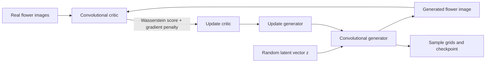
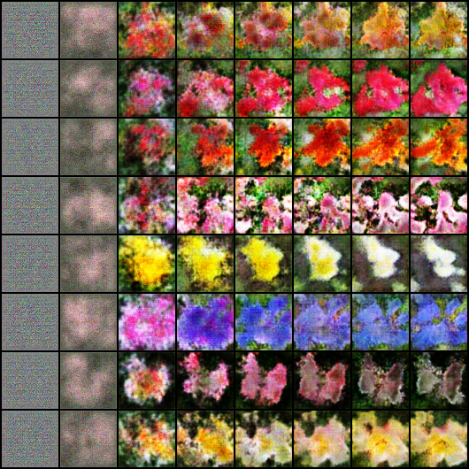
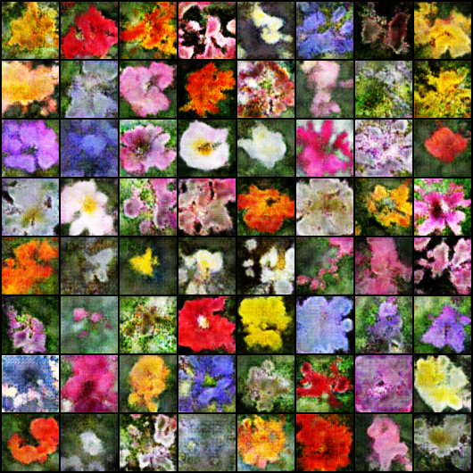
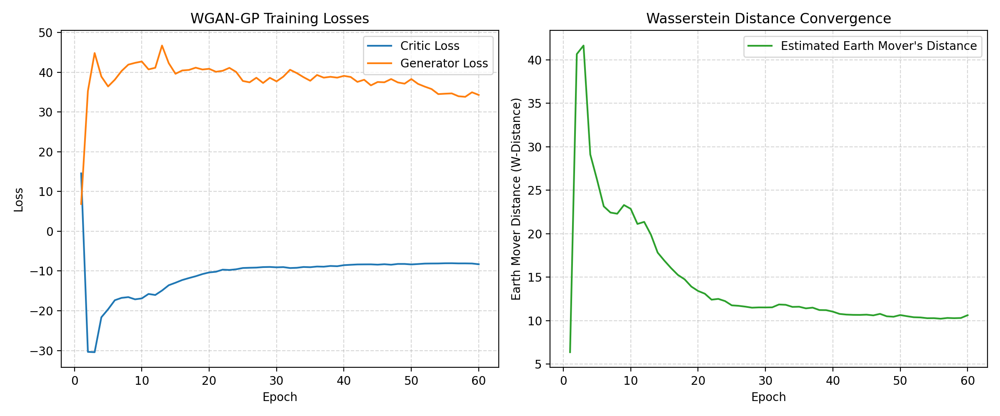

# 🌸 Image Generation with Convolutional WGAN-GP

> **A small image-generation project with a big idea:** teach a neural network to
> turn random noise into images that resemble a real visual world.

This project implements a convolutional **Wasserstein Generative Adversarial
Network with Gradient Penalty (WGAN-GP)** in PyTorch. It can train on Oxford
102 Flowers, CIFAR-10, or a local STL-10 image collection, then generate image
grids and latent-space interpolations.

## 🌷 The showcase: Oxford Flowers 102

For a presentation, **Oxford Flowers 102 is the recommended showcase**: its
variety of petal shapes, colors, and arrangements makes the generated images
especially engaging to explore. The flower model trains at **64 × 64** pixels.
The loader combines the dataset's training and validation splits and leaves the
test split out.

The project writes a consistent sample grid at the end of every epoch. Once
you train a model, those grids let you show how generation develops over time;
the checkpoint can also produce a fresh grid or a smooth latent interpolation.

## ✨ At a glance

| | |
|---|---|
| **Model** | Convolutional WGAN-GP |
| **Recommended dataset** | Oxford Flowers 102 |
| **Showcase resolution** | 64 × 64 RGB |
| **Other supported data** | CIFAR-10 (32 × 32), local STL-10 images (96 × 96) |
| **Framework** | PyTorch |
| **Outputs** | Model checkpoints, per-epoch sample grids, milestone progression, loss plot |

## 🧭 How the design took shape

The model is the result of a sequence of practical choices. Each one addresses
a different part of the image-generation problem.

### 1. Start with the image, not just its pixels

An RGB image is more than a long list of unrelated numbers. Nearby pixels tend
to form edges, colors, and textures; those local patterns combine into petals,
leaves, and larger shapes.

A fully connected network can learn image mappings, but it first flattens the
image into a vector. It does not naturally encode which pixels are neighbors,
and dense layers can require many parameters to model repeated visual
structures.

### 2. Give the networks a spatial inductive bias

Convolutions process local neighborhoods and reuse the same filters across the
image. That weight sharing makes them a natural fit for learning visual
patterns. In this project, the generator uses transposed convolutions to grow
a small feature map into an image, while the critic uses convolutions to
progressively summarize an image.

This is why the project uses a **convolutional GAN architecture** rather than
a basic dense, flattened-pixel architecture. It is an architectural
motivation, not a claim that this repository includes a controlled
convolutional-versus-dense benchmark.

### 3. Make generation adversarial

A GAN has two networks with competing goals:

- The **generator** turns a random latent vector into a synthetic image.
- The **discriminator** in a standard GAN learns to distinguish real images
  from generated ones.

As the discriminator improves, the original GAN objective can provide weak or
unhelpful gradients to the generator, especially when real and generated
images are far apart. Training can also become unstable or concentrate on too
few kinds of outputs (mode collapse).

### 4. Replace the discriminator objective with Wasserstein distance

Wasserstein GAN (WGAN) replaces the discriminator's probability with a
real-valued **critic score**. The critic estimates how far the generated
distribution is from the real one under the Wasserstein-1, or Earth Mover's,
objective. This can provide a more useful learning signal when the two
distributions do not yet overlap.

The critic is not a classifier: it has **no sigmoid output**, and its scores
are not probabilities. The generator learns to increase the scores of its
images.

### 5. Enforce the constraint with a gradient penalty

WGAN requires its critic to be 1-Lipschitz. Weight clipping is one way to
approximate that constraint, but it can restrict the critic too severely.
WGAN-GP instead penalizes the critic when the gradient norm deviates from 1
at points interpolated between real and generated images.

The result is the training approach used here: a convolutional generator and
critic, Wasserstein losses, and a gradient penalty.

## 🧠 What the networks do

### Generator

The generator starts from a **100-dimensional random latent vector**. For the
64 × 64 flower model, transposed-convolution blocks expand its spatial feature
map through **4 × 4 → 8 × 8 → 16 × 16 → 32 × 32 → 64 × 64**. Batch
normalization and ReLU activations are used in intermediate blocks; a final
`Tanh` produces RGB values in `[-1, 1]`.

### Critic

The critic maps a 64 × 64 RGB image down through convolutional stages to one
real-valued score. It uses LeakyReLU activations and instance normalization
in intermediate layers. As recommended for WGAN-GP, it does not use batch
normalization.

### The WGAN-GP objectives

For real image \(x\), generated image \(G(z)\), critic \(C\), and interpolated
sample \(\hat{x} = \alpha x + (1-\alpha)G(z)\), the code uses:

```text
L_C = E[C(G(z))] - E[C(x)] + λ · GP
L_G = -E[C(G(z))]

GP  = E[(||∇C(x̂)||₂ - 1)²]
```

The gradient-penalty weight defaults to **λ = 10**. The critic is updated
**five times** for each generator update by default, helping it provide a
useful learning signal. Both networks use Adam with learning rate `1e-4` and
betas `(0.0, 0.9)`.

## 🗺️ Training flow



## 🚀 Get started

### 1. Set up Python and dependencies

Use a Python environment with PyTorch and torchvision installed. Choose the
PyTorch installation command appropriate for your operating system and
accelerator from the [official PyTorch instructions](https://pytorch.org/get-started/locally/),
then install the remaining project dependencies:

```bash
python -m pip install numpy matplotlib pillow
```

### 2. Train the Oxford Flowers showcase model

```bash
python train.py \
  --flowers \
  --epochs 100 \
  --batch_size 64 \
  --milestone_interval 10 \
  --results_dir results_flowers
```

The first run downloads the Oxford Flowers 102 data through `torchvision`, so
an internet connection is needed for that initial download. Use `--data_root`
to select a different download location. The training script automatically
uses CUDA when available, then Apple Silicon MPS when available, and otherwise
CPU.

### 3. Generate a flower sample grid

After training, load the saved generator checkpoint:

```bash
python generate.py \
  --checkpoint results_flowers/checkpoints/generator.pth \
  --img_size 64 \
  --num_images 64 \
  --output flowers_samples.png
```

### 4. Explore the latent space

Interpolate between two random latent vectors to see how generated images
change along a path:

```bash
python generate.py \
  --checkpoint results_flowers/checkpoints/generator.pth \
  --img_size 64 \
  --interpolate \
  --steps 10 \
  --output flowers_interpolation.png
```

## 🪻 Other supported training data

### CIFAR-10

```bash
python train.py --epochs 50 --batch_size 64 --results_dir results_cifar10
```

The script downloads CIFAR-10 through `torchvision` and trains at 32 × 32.
To train on CIFAR-10's automobile class only:

```bash
python train.py \
  --cars_only \
  --epochs 50 \
  --batch_size 64 \
  --results_dir results_cars
```

### STL-10 local images

The STL-10 loader expects image files under
`data/STL10/unlabeled_images/` and trains at 96 × 96:

```bash
python train.py \
  --stl10 \
  --epochs 50 \
  --batch_size 64 \
  --results_dir results_stl10
```

Place the extracted STL-10 unlabeled images in that folder before training.

## 🛠️ Useful training options

| Option | Default | Purpose |
|---|---:|---|
| `--epochs` | `50` | Number of training epochs |
| `--batch_size` | `64` | Images per batch |
| `--lr` | `0.0001` | Adam learning rate |
| `--z_dim` | `100` | Latent-vector size |
| `--n_critic` | `5` | Critic updates per generator update |
| `--lambda_gp` | `10.0` | Gradient-penalty coefficient |
| `--milestone_interval` | `10` | Epoch interval for milestone grids |
| `--data_root` | `./data` | Dataset download or image root |
| `--results_dir` | `./results` | Output directory |

Run `python train.py --help` or `python generate.py --help` to see the
available command-line options.

## 📁 Project layout

```text
GAN project/
├── models.py       # Convolutional generator and critic
├── train.py        # Dataset loaders, WGAN-GP training, and visual checkpoints
├── generate.py     # Sample grids and latent-space interpolation
├── data/           # Local/downloaded datasets (gitignored)
├── results_flowers/ # Oxford Flowers showcase checkpoints and visual results
└── results*/        # Other generated outputs (gitignored)
```

Training creates an output directory with this structure:

```text
results_flowers/
├── checkpoints/
│   ├── generator.pth
│   └── critic.pth
├── samples/                  # One fixed-noise sample grid per epoch
├── milestones/               # Selected epoch grids
├── milestones_progression.png
└── training_metrics.png
```

The same fixed set of latent vectors is used for the per-epoch grids, making
visual comparisons across training epochs easier. The separate `generate.py`
script samples fresh latent vectors for new outputs.

## 🌸 Oxford Flowers results

The repository includes the Oxford Flowers run's checkpoints, training
samples, milestone grids, and training plots. These are the actual outputs
saved by the project, included so you can inspect the chosen showcase without
running training first.

### Training progression

The progression below compares fixed latent vectors at successive training
milestones:



### Generated samples at epoch 60

Each tile is a generated 64 × 64 sample:



### Training diagnostics

The saved curves are useful for inspecting training behavior, but the
Wasserstein estimate and GAN losses are not direct measures of perceptual
image quality:



## 🔎 Interpreting the results

The milestone progression and sample grids are useful for a presentation:
they show whether recognizable flower-like structure emerges and how outputs
change over training. The loss plot is a diagnostic aid, but GAN losses are
not a direct image-quality score; judge them alongside generated samples.

This project does not include a vanilla-GAN baseline or an automated image
quality benchmark such as FID. Therefore, the explanation above describes the
motivation for the selected architecture and objective, rather than reporting
a measured head-to-head result. Training quality can vary with hardware,
random initialization, and runtime.

## 📚 References

- Arjovsky, Chintala, and Bottou. [*Wasserstein GAN*](https://arxiv.org/abs/1701.07875), 2017.
- Gulrajani et al. [*Improved Training of Wasserstein GANs*](https://arxiv.org/abs/1704.00028), NeurIPS 2017.
- Radford, Metz, and Chintala. [*Unsupervised Representation Learning with Deep Convolutional Generative Adversarial Networks*](https://arxiv.org/abs/1511.06434), 2016.
- Nilsback and Zisserman. [*Automated Flower Classification over a Large Number of Classes*](https://www.robots.ox.ac.uk/~vgg/publications/2008/Nilsback08/), 2008.

## 👥 Project team

- Utkarsh Gupta (23/IT/167)
- Sanshubh Gupta (23/IT/149)
- Sachin Chopra (23/IT/143)
